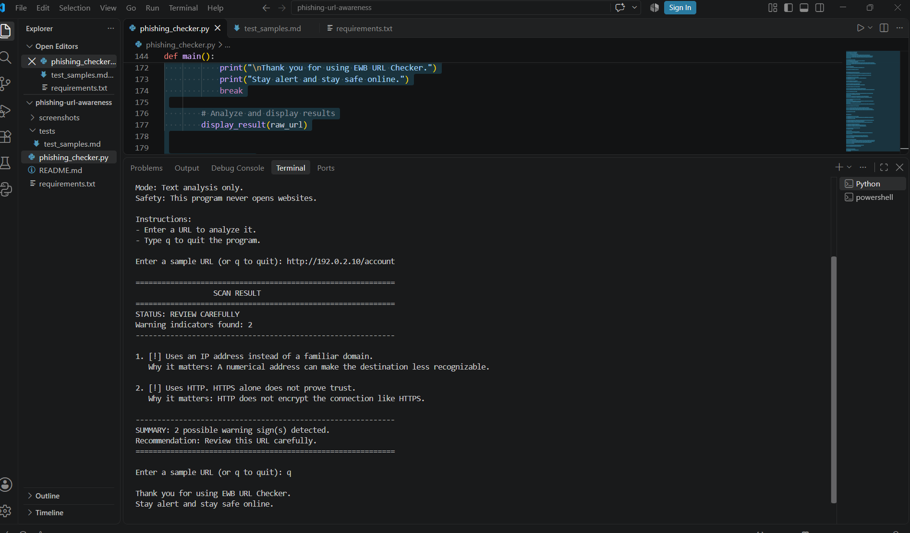
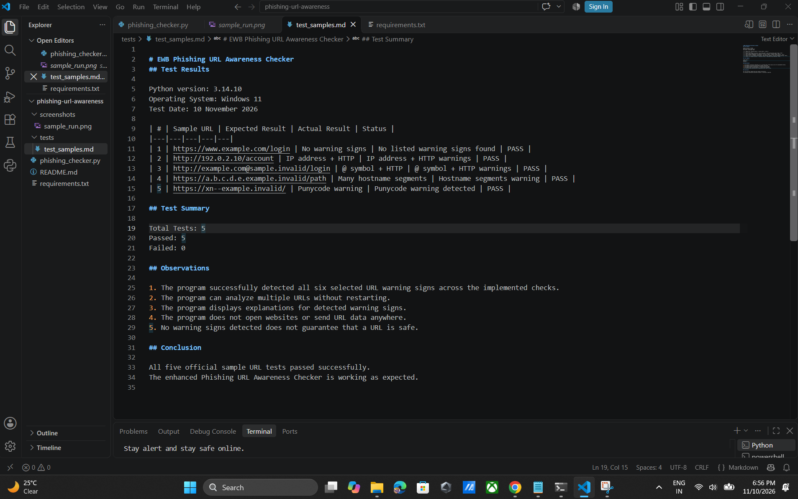

# EWB Phishing URL Awareness Checker

**A Python-based cybersecurity mini project for identifying suspicious characteristics in website URLs.**

## 1. Project Overview

Phishing is a cyberattack in which attackers use fake websites, emails or messages to trick people into sharing sensitive information such as passwords, banking details and OTPs.

The **Phishing URL Awareness Checker** is a Python-based command-line application that analyzes URL text and identifies selected warning signs commonly associated with suspicious links.

The program helps users understand potential URL risks and encourages safer browsing habits.

**Important:** This application only analyzes URL text. It does not open websites, connect to external servers or guarantee that a URL is safe.

## 2. Project Objectives

- Understand phishing attacks and suspicious URLs.
- Identify common warning signs in website addresses.
- Develop a cybersecurity tool using Python.
- Practise Python functions, regular expressions and URL parsing.
- Promote cybersecurity awareness.

## 3. Technologies Used

| Technology | Purpose |
|---|---|
| Python 3.14.10 | Programming language |
| Visual Studio Code | Code editor |
| Windows 11 | Development environment |
| Git and GitHub | Version control and project publishing |

## 4. Features

The application checks six URL warning signs:

1. **@ Symbol Detection:** Identifies the presence of an @ symbol in a URL.
2. **URL Length Detection:** Flags URLs longer than 100 characters.
3. **IP Address Detection:** Identifies IP-address hostnames instead of familiar domain names.
4. **Hostname Segment Detection:** Flags hostnames containing five or more segments.
5. **Punycode Detection:** Identifies hostnames containing the `xn--` marker.
6. **HTTP Detection:** Identifies URLs using HTTP instead of HTTPS.

### Additional Improvements

- Continuous checking of multiple URLs without restarting.
- Clear warning summary and recommendations.
- Explanations for detected warning signs.
- Handling of malformed URL parsing input.
- Improved terminal output.
- Option to exit the program using `q`.

## 5. Project Structure

```text
phishing-url-awareness/
│
├── phishing_checker.py
├── README.md
├── requirements.txt
│
├── tests/
│   └── test_samples.md
│
└── screenshots/
    ├── sample_run.png
    └── test_results.png
```

## 6. Requirements

- Windows 11 or another supported operating system.
- Python 3.10 or newer.
- Visual Studio Code (recommended).

No additional Python packages or external API keys are required.

The project uses Python's built-in libraries:

- `re`
- `urllib.parse`

## 7. How to Run the Project

### Step 1: Clone or download the repository

```bash
git clone YOUR-GITHUB-REPOSITORY-URL
```

### Step 2: Open the project folder

```bash
cd phishing-url-awareness
```

### Step 3: Run the Python program

On Windows:

```bash
py phishing_checker.py
```

On Linux or macOS:

```bash
python3 phishing_checker.py
```

### Step 4: Enter a sample URL

Example:

```text
http://192.0.2.10/account
```

The program analyzes the URL and displays the detected warning signs.

Type `q` to exit.

## 8. Example Output

```text
EWB PHISHING URL AWARENESS CHECKER

Enter a sample URL (or q to quit):
http://192.0.2.10/account

STATUS: REVIEW CAREFULLY

Warning indicators found: 2

1. Uses an IP address instead of a familiar domain.
2. Uses HTTP instead of HTTPS.

Recommendation: Review this URL carefully.
```

## 9. Testing

The application was tested using five sample URLs provided in the EWB project workbook.

| Test | Description | Result |
|---|---|---|
| 1 | Normal example URL | PASS |
| 2 | IP address and HTTP | PASS |
| 3 | @ symbol and HTTP | PASS |
| 4 | Multiple hostname segments | PASS |
| 5 | Punycode hostname | PASS |

**Testing Summary:**

- Total test cases: 5
- Passed: 5
- Failed: 0

Detailed test observations are available in `tests/test_samples.md`.

## 10. Screenshots

### Sample Program Execution



### Test Results



## 11. Project Improvements

The basic program was enhanced with the following features:

1. Continuous URL checking using a loop.
2. A clear warning summary.
3. Better handling of malformed URL input.
4. Explanations of detected warning signs.
5. Improved terminal interface and formatting.

## 12. Limitations

- The application checks only six selected URL characteristics.
- It does not visit or scan websites.
- It does not check malware or website reputation.
- It does not use external threat intelligence services.
- A URL without detected warning signs may still be dangerous.
- HTTPS does not guarantee that a website is legitimate.

**No listed warning signs found does NOT mean a URL is safe.**

## 13. Safety and Ethical Use

This project is developed for educational and defensive cybersecurity awareness.

- Do not enter passwords or confidential information.
- Use the provided sample URLs for testing.
- Do not use the project to deceive people.
- Do not scan or probe websites without authorization.
- Never claim that this tool definitively identifies all phishing websites.

## 14. Author

**Name:** Deepak Panwar  
**Course:** EWB Cybersecurity Internship  
**Project:** Phishing URL Awareness Checker

---

**BUILD • TEST • DOCUMENT • SUBMIT**